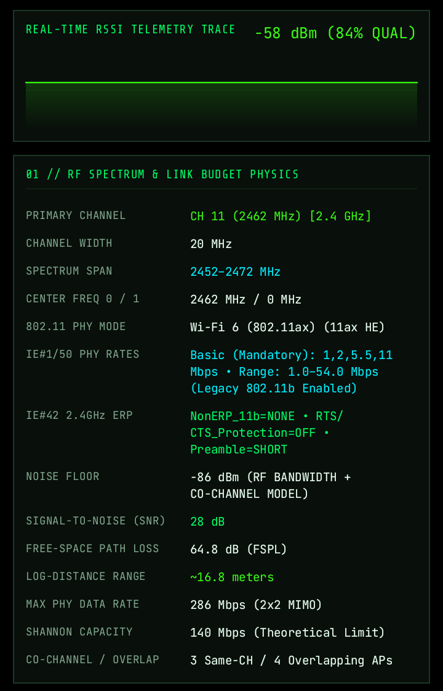
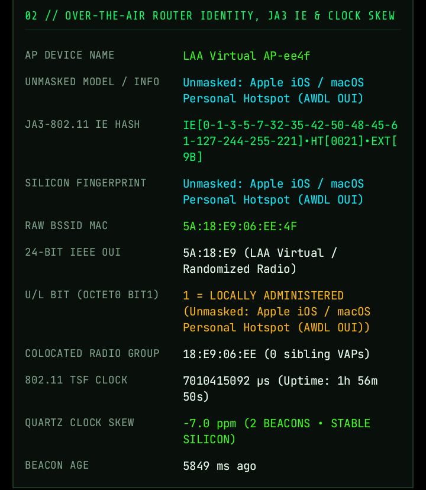
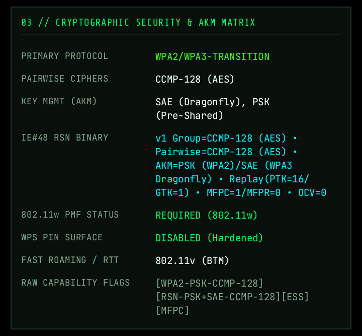
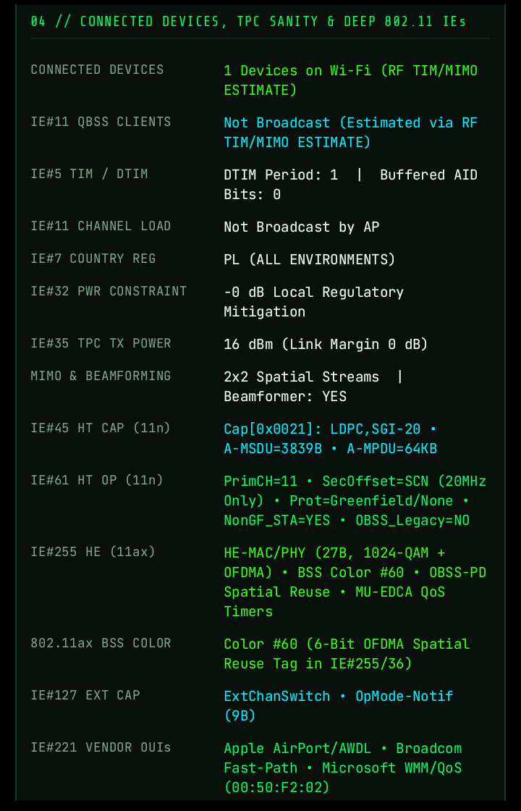
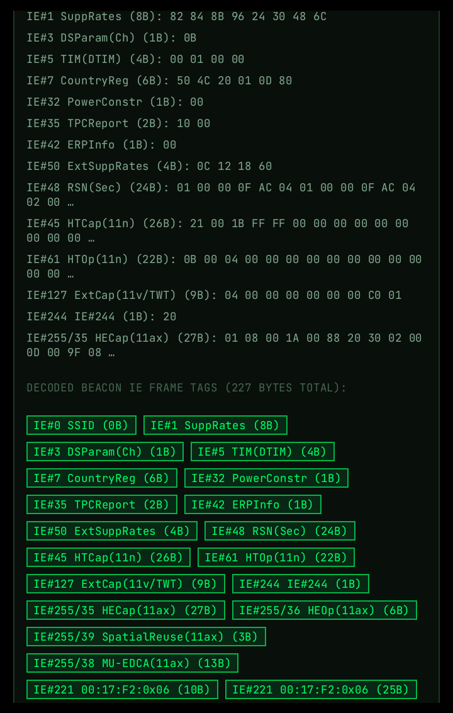

Before using the app, you must have Wi-Fi turned on and grant Precise Location access when prompted. Android's operating system security model treats nearby Wi-Fi broadcast data as location-sensitive because wireless access points can be used to determine physical coordinates. Without location access enabled, Android blocks apps from receiving scan results, hiding raw BSSID MAC addresses, zeroing out RSSI signal levels, and stripping away raw 802.11 beacon Information Elements. Granting this permission is strictly required by the Android system so the app can talk to the Wi-Fi hardware and extract actual wireless frames.

## Screenshots

### 1) RF spectrum and link-budget telemetry
Shows the real-time RSSI trace for a selected access point alongside primary channel, channel width, spectrum span, PHY mode, noise floor, SNR, path loss, estimated range, PHY rate, Shannon capacity, and co-channel overlap.

### 2) Over-the-air router identity and clock analysis
Displays the AP identity and unmasked device information, JA3-style 802.11 information-element hash, silicon fingerprint, randomized BSSID details, colocated radios, beacon timing, and quartz clock skew.

### 3) Cryptographic security and AKM matrix
Summarizes WPA2/WPA3 transition security, pairwise ciphers, SAE and PSK key management, RSN capabilities, management-frame protection, WPS status, and fast-roaming support.

### 4) Connected devices and deep 802.11 information elements
Shows estimated connected devices, QoS and TIM/DTIM state, regulatory and transmit-power constraints, MIMO and beamforming, HT/HE capabilities, BSS color, extended capabilities, and vendor OUIs.

### 5) Decoded beacon information-element frame
Provides the raw beacon IE payload together with decoded tags for SSID, supported rates, channel parameters, TIM, country and power constraints, RSN, HT/VHT/HE capabilities, spatial reuse, MU-EDCA, and vendor extensions.

