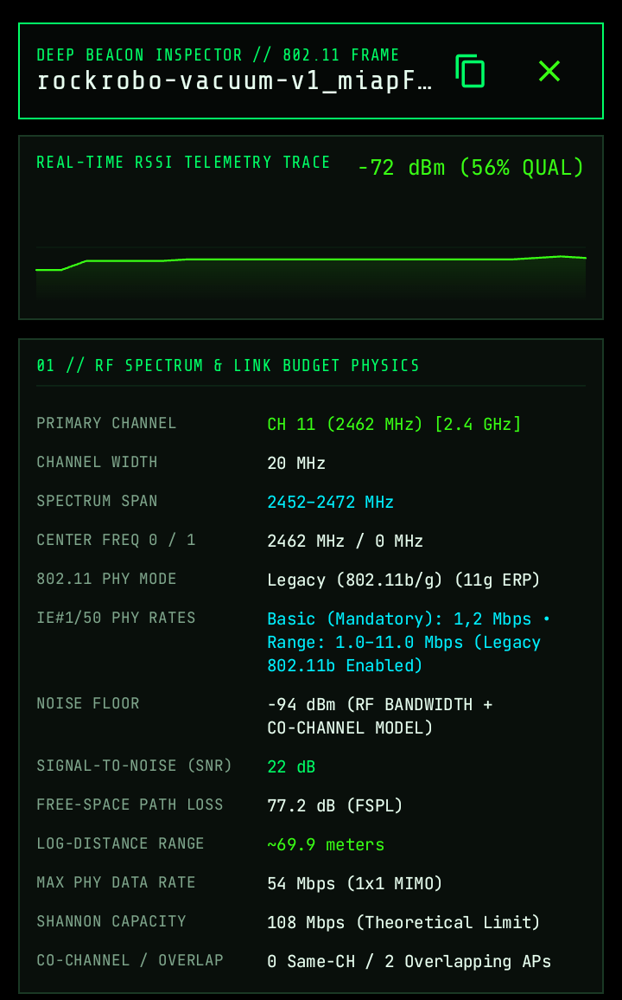
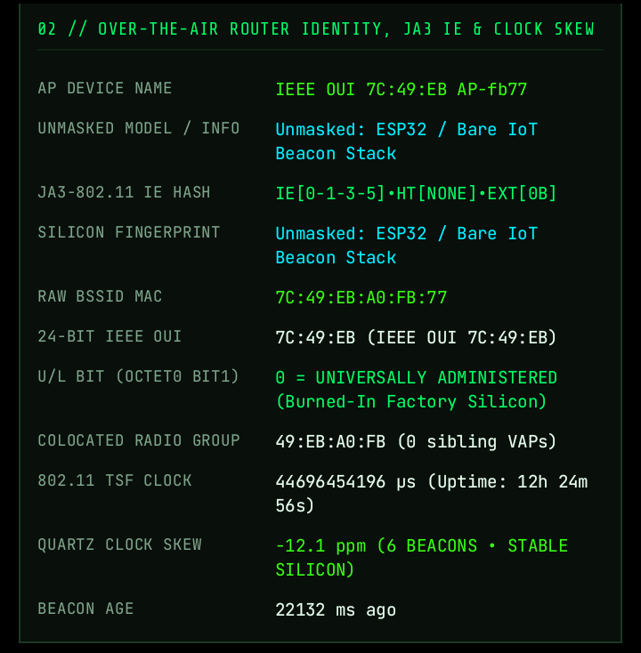
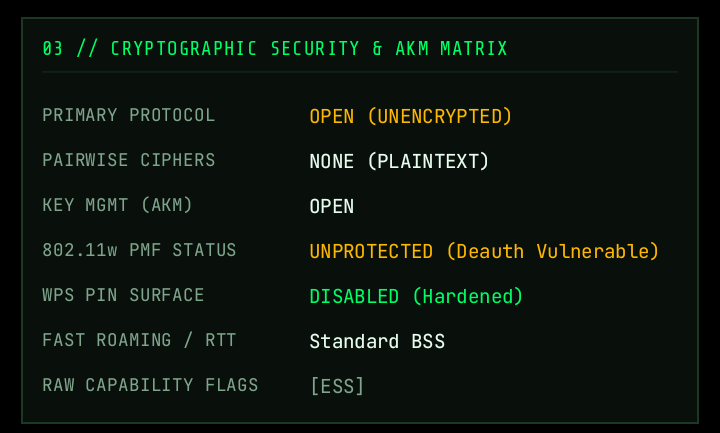
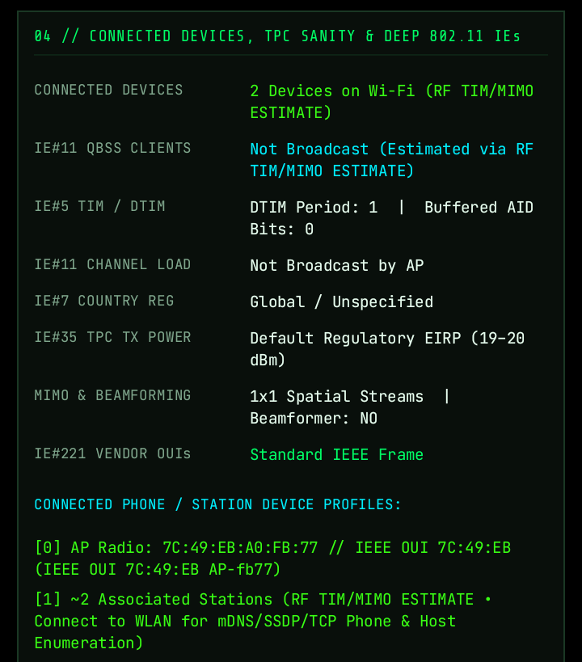

Before using the app, you must have Wi-Fi turned on and grant Precise Location access when prompted. Android's operating system security model treats nearby Wi-Fi broadcast data as location-sensitive because wireless access points can be used to determine physical coordinates. Without location access enabled, Android blocks apps from receiving scan results, hiding raw BSSID MAC addresses, zeroing out RSSI signal levels, and stripping away raw 802.11 beacon Information Elements. Granting this permission is strictly required by the Android system so the app can talk to the Wi-Fi hardware and extract actual wireless frames.

## Examples of what the app can show

### Beacon signal and radio details

An example of live RSSI telemetry, channel information, PHY rates, noise floor, signal-to-noise ratio, path loss, and estimated range.

### Router identity and clock analysis

An example of access-point identity, BSSID and vendor information, radio grouping, beacon timing, and clock skew.

### Wireless security details

An example of encryption, cipher, key-management, protected-management-frame, and WPS status.

### Connected devices and 802.11 information elements

An example of connected-device estimates, channel and country details, transmit power, MIMO capabilities, and vendor information.
